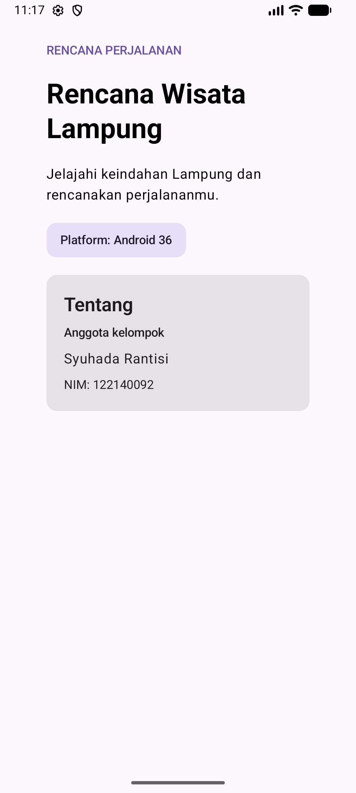

# Rencana Wisata Lampung

Proyek kelompok Kotlin Multiplatform dengan Compose Multiplatform untuk tema **Rencana Wisata Lampung**. Aplikasi menampilkan nama tema, platform yang digunakan, dan identitas anggota di bagian Tentang.

## Anggota

| Nama                    | NIM       |
|-------------------------|-----------|
| Syuhada Rantisi (Ketua) | 122140092 |
| M. Rif'at Syauki        | 124140138 |
| Akhdan Arif Prayoga     | 122140099 |
| Muhammad Refah Alfarabi | 124140216 |

## Menjalankan aplikasi

- Android: `./gradlew :androidApp:assembleDebug`, lalu jalankan melalui Android Studio atau perangkat Android.
- Desktop: `./gradlew :desktopApp:run`.
- iOS: buka folder `iosApp` di Xcode dan jalankan aplikasi pada simulator atau perangkat.

Kode antarmuka bersama berada di `shared/src/commonMain`, dengan implementasi platform di masing-masing source set.

## Pengujian| M. Rif'at Syauki | 124140138 |

- Desktop: `./gradlew :shared:jvmTest`
- Android: `./gradlew :shared:testAndroidHostTest`
- iOS: `./gradlew :shared:iosSimulatorArm64Test`

## Tangkapan layar

Tampilan aplikasi pada emulator Android:

